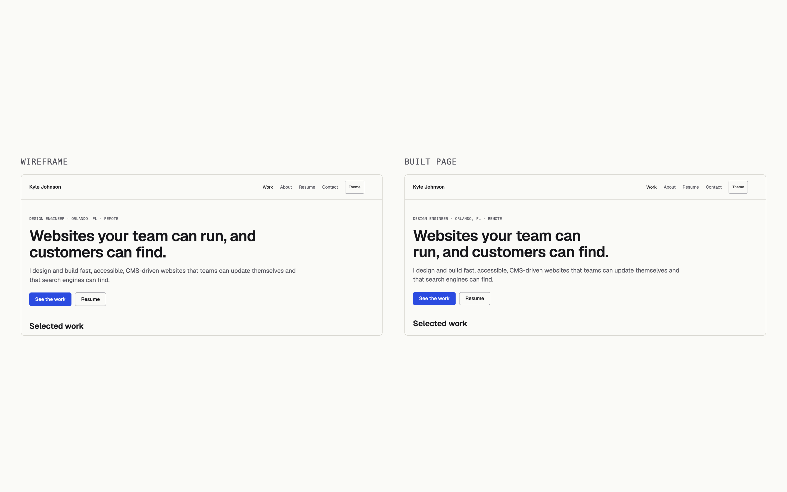
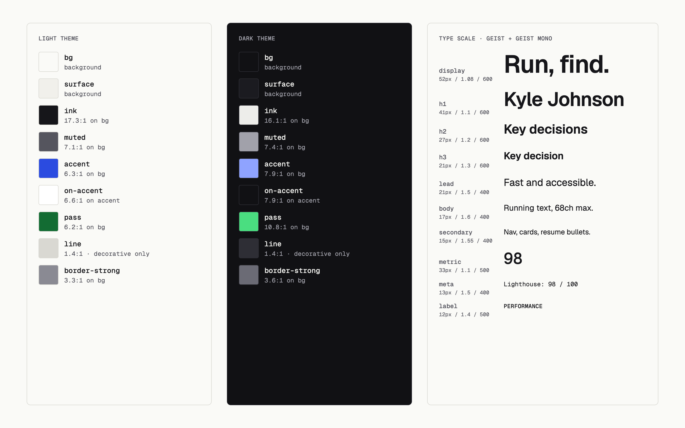
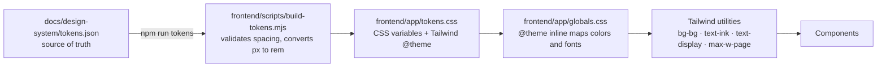
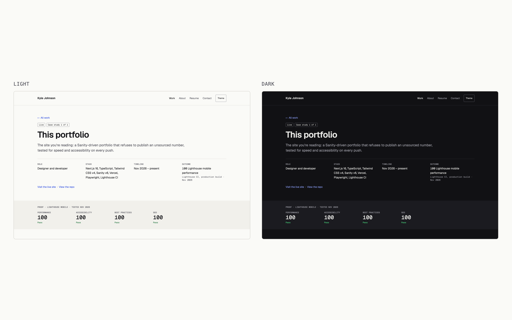

# Editorial Proof

The design system for Kyle Johnson's portfolio: a calm, type-led site where evidence is the decoration. Built for Claude Code to implement in Next.js 16 (App Router) + TypeScript + Tailwind CSS v4 + Sanity.

Positioning it serves: *I design and build fast, accessible, CMS-driven websites that teams can update themselves and that search engines can find.* Headline: *Websites your team can run, and customers can find.*

**On this page:** [Principles](#principles) · [Voice](#content-fundamentals-voice) · [Visual foundations](#visual-foundations) · [Accessibility](#accessibility-wcag-22-aa-non-negotiable) · [Tokens in depth](#tokens-in-depth) · [How tokens reach the page](#how-tokens-reach-the-page) · [Light and dark](#light-and-dark) · [Components](#components-v1) · [Honest placeholders](#honest-placeholders) · [Proof it holds up](#proof-it-holds-up) · [Design decisions](#design-decisions-and-their-tradeoffs) · [Changing the system](#changing-the-system)

## Principles

1. **Work in the first viewport.** On a 1280×800 laptop the first case study card starts above the fold (checked at 566px in the wireframes).
2. **Evidence over adjectives.** Every claim sits next to a number, a link or a screenshot. The Proof Strip is the signature component.
3. **Placeholders are honest.** Missing facts render as a dashed mono `Placeholder`, never as an invented number. Sanity validation blocks publishing a case study while any metric lacks a value, source or date.
4. **One accent.** `accent` is for links, the primary button, focus and the active nav item. `pass` appears only inside the Proof Strip.
5. **Motion is feedback only.** 150 ms `cubic-bezier(0.2, 0, 0, 1)` on hover and focus color/border changes. Nothing animates on load. All transitions off under `prefers-reduced-motion`.
6. **Light and dark from day one.** System setting by default, manual toggle sets `data-theme` on `<html>` before paint.

## Content fundamentals (voice)

- Plain, direct, first person singular. Short sentences.
- Lead with the outcome, then the problem. "Don't bury the lede."
- Name things the way a hiring manager would: "case study", "launch", "Lighthouse score", not internal jargon.
- No superlatives, no exclamation marks, no emoji.
- Numbers carry a source and a date: `98 · Lighthouse mobile · Nov 2026`.
- Teaching is framed as an edge: "I teach, so I build things people can run without me."

## Visual foundations

- **Type:** Geist Sans for everything; Geist Mono for data, labels, badges and placeholders. Load with `next/font/google` (`Geist`, `Geist_Mono`) and expose as `--font-geist-sans` / `--font-geist-mono`. Styles: `display` 52 → `h1` 41 → `h2` 27 → `h3` 21 → `lead` 21 → `body` 17 → `secondary` 15 → `meta` 13 → `label` 12. `display` drops to 36px under 760px. Headings `text-wrap: balance`.
- **Color:** warm paper and ink with one cobalt accent. Neutrals lean warm in light, cool in dark. All text pairs pass WCAG 2.2 AA in both themes (ratios are in each token's usage note).
- **Layout:** `container-page` 1200px, gutter `space-4` on phones and `space-6` from 760px. Prose capped at `container-prose`. Sections separated by `space-16` (home) or `space-18` (case study). Flex/grid with `gap`, never sibling margins.
- **Surfaces:** borders (`line`) mark cards; `surface` fills mark bands. No shadows. No gradients.
- **Imagery:** real screenshots inside `BrowserFrame`; no device mockups, no stock photos. Alt text is a required Sanity field.

## Accessibility (WCAG 2.2 AA, non-negotiable)

- `SkipLink` is the first tab stop on every page and becomes visible on focus.
- Focus: `outline: 2px solid var(--accent); outline-offset: 3px` on `:focus-visible`.
- Buttons and toggles are at least `target-min` (44px).
- Status never by color alone: badges carry text; Proof Strip scores carry the word "Pass".
- Heading levels never skip. One `h1` per page.

---

## Tokens in depth

[`tokens.json`](tokens.json) is the single source of truth. Every value below comes from it.

### Color

Contrast ratios are computed from the hex values against `bg` (WCAG 2.x relative luminance), and they match the usage notes in `tokens.json`. Text needs 4.5:1; UI boundaries need 3:1.

| Token | Light | Dark | Light ratio | Dark ratio | Used for | Tailwind |
| --- | --- | --- | --- | --- | --- | --- |
| `bg` | `#FAFAF7` | `#111114` | — | — | Page background | `bg-bg` |
| `surface` | `#F1F0EB` | `#1B1B20` | — | — | Bands: Proof Strip, Contact, About teaser | `bg-surface` |
| `ink` | `#16161A` | `#EDEDEA` | 17.3:1 | 16.1:1 | Text and headings | `text-ink` |
| `muted` | `#55555E` | `#A1A1AA` | 7.1:1 | 7.4:1 | Secondary text, labels | `text-muted` |
| `accent` | `#2B4BE0` | `#8FA3FF` | 6.3:1 | 7.9:1 | Links, primary button, focus, active state | `text-accent`, `bg-accent` |
| `on-accent` | `#FFFFFF` | `#111114` | 6.6:1 on accent | 7.9:1 on accent | Text on the primary button | `text-on-accent` |
| `pass` | `#136C33` | `#4ADE80` | 6.2:1 | 10.8:1 | Proof Strip "Pass" only | `text-pass` |
| `line` | `#D9D8D2` | `#2E2E35` | 1.4:1 | 1.4:1 | Decorative hairlines; never a control's only edge | `border-line` |
| `border-strong` | `#8A8A93` | `#6B6B75` | 3.3:1 | 3.6:1 | Buttons, badges, inputs, placeholders | `border-border-strong` |

On `surface` the margins shrink but still pass: `muted` 6.5:1 / 6.7:1, `accent` 5.8:1 / 7.2:1, `border-strong` 3.0:1 / 3.3:1.

### Type

| Style | Size | Line height | Weight | Tracking | Family | Tailwind |
| --- | --- | --- | --- | --- | --- | --- |
| `display` | 52px (36px under 760px) | 1.08 | 600 | -0.02em | Geist | `text-display` |
| `h1` | 41px | 1.1 | 600 | -0.02em | Geist | `text-h1` |
| `h2` | 27px | 1.2 | 600 | — | Geist | `text-h2` |
| `h3` | 21px | 1.3 | 600 | — | Geist | `text-h3` |
| `lead` | 21px | 1.5 | 400 | — | Geist | `text-lead` |
| `body` | 17px | 1.6 | 400 | — | Geist | `text-body` |
| `secondary` | 15px | 1.55 | 400 | — | Geist | `text-secondary` |
| `metric` | 33px | 1.1 | 500 | — | Geist Mono, tabular figures | `text-metric` |
| `meta` | 13px | 1.5 | 400 | — | Geist Mono | `text-meta` |
| `label` | 12px | 1.4 | 500 | 0.02em | Geist Mono, uppercase | `text-label` |

Font sizes are generated in `rem`, so they scale with the visitor's browser font setting. Each Tailwind class sets size, line height, weight and tracking together, so a style can't be half-applied.

### Space, radius and size

| Token | Value | Tailwind |
| --- | --- | --- |
| `space-1` … `space-24` | 4px × the number | `p-1` … `p-24`, `gap-6`, etc. |
| `radius-sm` / `md` / `lg` / `full` | 4 / 6 / 8 / 999px | `rounded-sm` … `rounded-full` |
| `container-page` | 1200px | `max-w-page` |
| `container-prose` | 68ch | `max-w-reading` |
| `container-resume` | 880px | `max-w-resume` |
| `target-min` | 44px | `min-h-target`, `min-w-target` |
| breakpoint | 760px | `md:` |

The `space-N` tokens follow Tailwind's 4px scale by number (`space-6` = `p-6` = 24px). The token generator checks this and fails the build if they ever drift apart.

## How tokens reach the page

- **Generated, not hand-written.** [`build-tokens.mjs`](../../frontend/scripts/build-tokens.mjs) writes [`tokens.css`](../../frontend/app/tokens.css). Nobody edits the CSS by hand.
- **Tailwind's defaults are cleared.** The generated theme starts with `--color-*: initial`, `--text-*: initial`, `--radius-*: initial`, `--shadow-*: initial` and `--container-*: initial`. Only token utilities exist, so `text-red-500` or `shadow-lg` produce no CSS at all. Staying on-system is the only option, not a guideline.
- **Colors stay live.** [`globals.css`](../../frontend/app/globals.css) maps colors with `@theme inline` (for example `--color-ink: var(--ink)`), so `text-ink` reads the current theme's variable instead of a fixed hex.

## Light and dark

- **The system decides by default.** With no saved choice, `@media (prefers-color-scheme: dark)` switches the variables, so there's no JavaScript involved.
- **The toggle cycles System → Light → Dark.** It's a real `<button>` labelled "Switch color theme (current: Light)", 44px tall. The choice is saved in `localStorage`; "System" clears it.
- **No flash of the wrong theme.** A tiny inline script in `<head>` ([`lib/theme.ts`](../../frontend/lib/theme.ts)) reads the saved choice and sets `data-theme` on `<html>` before the first paint. The toggle reads the same value with `useSyncExternalStore`, so React never disagrees with the page it hydrates.
- **Dark is designed, not inverted.** Neutrals lean cool in dark and warm in light. The accent lightens (`#2B4BE0` → `#8FA3FF`) and `on-accent` flips to dark text, so the primary button keeps its contrast in both modes.

## Components (v1)

SkipLink · SiteHeader (with ThemeToggle) · SiteFooter · Button · StatusBadge · Placeholder · CaseStudyCard · ProofStrip · TLDR · DecisionCard · BrowserFrame · PortableText · ResumeBlock. Each has guidelines and a live preview in [`components.md`](components.md).

Only these components ship in v1. A new component needs Kyle's approval.

| Component | Source | Renders on | Notes |
| --- | --- | --- | --- |
| SkipLink | [`SkipLink.tsx`](../../frontend/app/components/SkipLink.tsx) | Server | First tab stop; visible on focus |
| SiteHeader | [`SiteHeader.tsx`](../../frontend/app/components/SiteHeader.tsx) | Client | Needs the current URL for `aria-current="page"` |
| ThemeToggle | [`ThemeToggle.tsx`](../../frontend/app/components/ThemeToggle.tsx) | Client | Reads and writes the saved theme |
| SiteFooter | [`SiteFooter.tsx`](../../frontend/app/components/SiteFooter.tsx) | Server | Links come from Sanity; missing ones are left out |
| Button | [`Button.tsx`](../../frontend/app/components/Button.tsx) | Server | A link when it navigates, a `<button>` when it acts |
| StatusBadge | [`StatusBadge.tsx`](../../frontend/app/components/StatusBadge.tsx) | Server | Text label, never color alone |
| Placeholder | [`Placeholder.tsx`](../../frontend/app/components/Placeholder.tsx) | Server | Draft preview only |
| CaseStudyCard | [`CaseStudyCard.tsx`](../../frontend/app/components/CaseStudyCard.tsx) | Server | One link, no nested links; decorative screenshot (`alt=""`) |
| ProofStrip | [`ProofStrip.tsx`](../../frontend/app/components/ProofStrip.tsx) | Server | `<dl>`; a score without a test date is never shown |
| TLDR | [`TLDR.tsx`](../../frontend/app/components/TLDR.tsx) | Server | Role, Stack, Timeline, Outcome as a `<dl>` |
| DecisionCard | [`DecisionCard.tsx`](../../frontend/app/components/DecisionCard.tsx) | Server | Chose / Instead of / Because / Cost |
| BrowserFrame | [`BrowserFrame.tsx`](../../frontend/app/components/BrowserFrame.tsx) | Server | Fixed 16:10, so nothing shifts while the image loads |
| PortableText | [`PortableText.tsx`](../../frontend/app/components/PortableText.tsx) | Server | Editors get `h3` only; links are underlined |
| ResumeBlock | [`ResumeBlock.tsx`](../../frontend/app/components/ResumeBlock.tsx) | Server | Mono section label over a hairline |

Only the header and theme toggle need JavaScript in the browser. Everything else renders on the server and ships as plain HTML.

## Honest placeholders

![An unfinished case study in draft preview. Facts that aren't in yet show as dashed boxes: [STACK], [START DATE], [ONE NUMBER + SOURCE], and [00] for each Lighthouse score.](images/draft-placeholders.png)

Principle 3 is enforced in two places:

- **In the Studio:** a case study can't be published while a number lacks a source or date, an image lacks alt text, Lighthouse scores lack a test date, or a named client hasn't confirmed permission. The rules live in [`validation.ts`](../../studio/src/schemaTypes/validation.ts), with unit tests.
- **On the page:** in draft preview, every missing fact renders as a dashed `Placeholder` naming what belongs there. A published page never shows one, because the Studio won't publish it with gaps.

## Proof it holds up

Every push runs [CI](../../.github/workflows/ci.yml), and a red check blocks the merge.

| Check | What it verifies |
| --- | --- |
| axe-core in Playwright ([`accessibility.spec.ts`](../../frontend/e2e/accessibility.spec.ts)) | WCAG 2.2 AA on every page in the sitemap, in light **and** dark mode, on desktop and phone |
| Playwright ([`pages.spec.ts`](../../frontend/e2e/pages.spec.ts)) | One `h1` per page, no skipped heading levels, no sideways scroll, skip link first, theme applied before paint, 404 for unknown pages |
| Lighthouse CI ([`lighthouserc.json`](../../frontend/lighthouserc.json)) | Mobile, three runs per page, median: 95+ in performance, accessibility, best practices and SEO |

Latest results (Nov 13, 2026, mobile, production build): Lighthouse 100 in accessibility, best practices and SEO on every published page; performance 100 on Contact and the case study, and 98–100 on Home across runs. 0 axe violations.

Pages come from `sitemap.xml`, so a new case study is tested the moment it's published.

## Design decisions and their tradeoffs

| Decision | Instead of | Because | Cost |
| --- | --- | --- | --- |
| Geist and Geist Mono via `next/font` | Inter | Inter reads as the default template font; `next/font` self-hosts with no layout shift | One more typeface choice to defend |
| One accent; green only in the Proof Strip | A palette of brand colors | Color then means something: blue is "you can act", green is "this passed" | Less visual variety |
| No shadows or gradients | Elevation to separate content | Borders and tinted bands are enough, and they look the same in both themes | Cards feel flatter |
| Breakpoint at 760px | Tailwind's 768px | The wireframes break at 760px | `md:` no longer matches Tailwind's docs |
| `max-w-reading` for the 68ch prose width | `max-w-prose` | Tailwind's built-in `max-w-prose` (65ch) can't be overridden and silently wins | A non-standard class name |
| No underlines on nav and footer links; underlines inside prose | Underlines everywhere | Nav links sit in labelled navigation; links in running text must not rely on color (WCAG 1.4.1) | Two link styles to keep consistent |
| Fixed 16:10 screenshot frame | The wireframe's 16:9 | `components.md` specifies 16:10, and a fixed ratio means zero layout shift | Some screenshots crop at the edges |
| Geist Mono not preloaded | Preloading both fonts | Mono only styles small labels; skipping the preload keeps it out of the way of the first image | Labels may swap fonts a moment late on slow connections |
| Card screenshots are decorative (`alt=""`) | Repeating the alt text inside every card link | The card title names the work; the case study page carries the descriptive alt | Screen reader users hear the screenshot description on the case study, not on the card |

## Changing the system

1. Edit [`tokens.json`](tokens.json).
2. Run `npm run tokens --workspace=frontend` to regenerate `frontend/app/tokens.css`.
3. Check contrast for any color you changed: 4.5:1 for text, 3:1 for UI boundaries, in both themes.
4. Push. CI re-runs axe in both themes and Lighthouse on every page, and blocks the merge if anything regresses.

A new component starts in [`components.md`](components.md) with its guidelines, and ships only after Kyle approves it.

## How it was implemented

The original handoff plan, as built:

1. **Tokens:** generated into `frontend/app/tokens.css` from `tokens.json`, imported in `frontend/app/globals.css` alongside Tailwind (see [How tokens reach the page](#how-tokens-reach-the-page)).
2. **Tailwind v4 mapping:** `@theme inline` maps colors and fonts, so utilities like `bg-bg text-ink border-line` follow the theme.
3. **Components:** [`components.css`](components.css) is the reference CSS for every component (`.kj-*` classes). Each was rebuilt in `frontend/app/components/<Name>.tsx` with Tailwind utilities; the `.kj-*` class names are not used in production.
4. **Scope:** only the 13 components listed above ship in v1.
5. **No raw hex values in components, and no animation libraries.** The only hex values live in `tokens.json` and the generated `tokens.css`.
